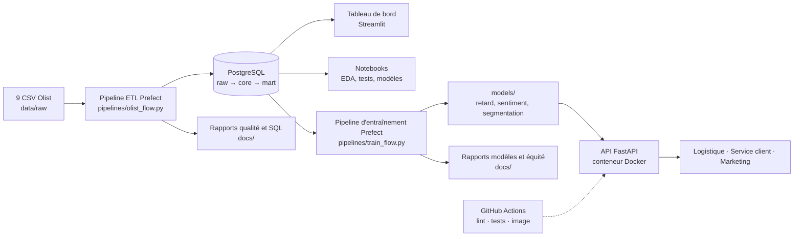
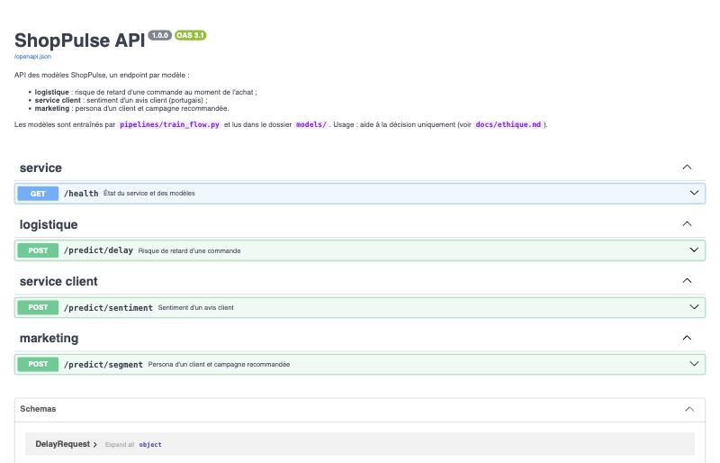
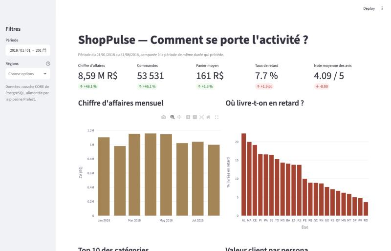
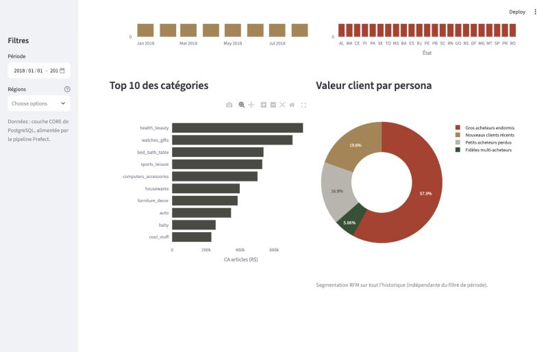

# ShopPulse — plateforme data & IA

[](https://github.com/Alibenaqa/shoppulse/actions/workflows/ci.yml)

**Mission flash de 10 jours pour ShopPulse**, une marketplace e-commerce
d'environ 3 000 vendeurs et 100 000 clients (données réelles Olist, Brésil,
2016-2018). La direction avait trois irritants : des données éparpillées,
un marketing qui cible tout le monde (seulement **3 %** des clients
repassent commande) et des retards de livraison découverts après coup (la
note moyenne tombe de **4,3 à 2,3** quand la commande arrive en retard).

Ce dépôt livre une **base consolidée et contrôlée**, **quatre réponses
métier** lisibles par un non-technicien et **trois modèles servis par une
API conteneurisée**, avec tests et intégration continue.

## En bref : les quatre questions métier

| Question | Pour qui | Réponse livrée | Résultat clé | Où |
|---|---|---|---|---|
| Qui sont nos clients et comment les cibler ? | Marketing | Segmentation RFM + K-means, 3 personas ciblées, 3 campagnes chiffrées | les « gros acheteurs endormis » (30 % des clients) pèsent **58 % de la valeur** ; reconquête estimée à ≈ 148 000 R$ de gain net | [notebook 03](notebooks/03_segmentation.ipynb), `POST /predict/segment` |
| Quelle commande risque d'arriver en retard ? | Logistique | Modèle de classification (gradient boosting) servi par l'API, avec audit d'équité par région | en surveillant 10 % des commandes, on capte **27 %** des retards en validation (10 % au hasard), 17 % sur l'été 2018 à cause d'une dérive | [notebook 04](notebooks/04_modele_retard.ipynb), [audit](notebooks/05_audit_equite.ipynb), `POST /predict/delay` |
| Que disent les clients dans leurs avis ? | Service client | Modèle de sentiment : TF-IDF + régression logistique comparé à un réseau GRU (PyTorch) | **94 %** des avis négatifs détectés ; **69 %** d'entre eux parlent de livraison | [notebook 06](notebooks/06_modele_sentiment.ipynb), `POST /predict/sentiment` |
| Comment se porte l'activité ? | Direction | Tableau de bord Streamlit à 5 indicateurs, branché sur la base | janvier-août 2018 : 8,59 M R$ de CA, 53 531 commandes, 7,7 % de retards | `streamlit run src/shoppulse/dashboard.py` |

## Architecture



- **Données** : les 9 CSV sont chargés tels quels dans la couche `raw`, puis
  typés et nettoyés dans la couche `core` (modèle relationnel avec clés
  primaires et étrangères). La couche `mart` contient la segmentation des
  clients. Chaque règle de nettoyage est écrite et numérotée dans
  [sql/transform_core.sql](sql/transform_core.sql).
- **Deux pipelines Prefect** : l'ETL recharge les données (rejouable à
  l'infini, sans doublon), l'entraînement réentraîne les modèles quand on
  le décide. Chacun régénère ses rapports dans `docs/`.
- **Service** : l'API lit les modèles dans `models/`. Les variables d'une
  nouvelle commande sont calculées par le même code que pendant
  l'entraînement (écart vérifié sur 200 commandes : 6 × 10⁻¹⁴).

### Arbitrages techniques

| Besoin | Choix | Pourquoi (coût, délai, performance, pérennité) |
|---|---|---|
| Base de données | PostgreSQL 16 (Docker) | gratuit, standard, fonctions de fenêtre et contraintes d'intégrité |
| Orchestration | **Prefect** plutôt qu'Airflow | flux en Python pur, aucun serveur à installer, démarrage en quelques secondes ; Airflow demande un scheduler, une base de métadonnées et un serveur web |
| Tableau de bord | **Streamlit** plutôt que Metabase | tout en Python, une commande pour lancer, versionné dans le dépôt |
| Modèles | scikit-learn, PyTorch | baselines et gradient boosting éprouvés ; réseau de neurones demandé pour le sentiment |
| Langue des avis | entraînement direct en portugais | gratuit, aucun avis envoyé à un service externe (RGPD), API légère |
| API | FastAPI + Pydantic | validation des entrées et documentation OpenAPI automatiques |
| Déploiement | Docker | image sans PyTorch, versions des bibliothèques figées, modèles montés au lancement |

## Installation (≈ 15 minutes)

Testée sur un clone neuf du dépôt : chaque étape ci-dessous a été
chronométrée (Mac Apple M3, macOS 14, connexion domestique).

**Prérequis** : Python 3.11, Docker Desktop lancé, un compte Kaggle (gratuit)
et environ 3 Go d'espace disque.

```bash
git clone https://github.com/Alibenaqa/shoppulse.git
cd shoppulse
python3.11 -m venv .venv
source .venv/bin/activate          # Windows : .venv\Scripts\activate
```

Sous **Linux** uniquement, installer d'abord la version CPU de PyTorch (sinon
pip télécharge la version GPU, plus de 2 Go) :

```bash
pip install torch --index-url https://download.pytorch.org/whl/cpu
```

Puis, sur tous les systèmes :

```bash
pip install -e ".[pipeline,dashboard,notebooks,dev]"
cp .env.example .env               # Windows : copy .env.example .env
docker compose -f infra/docker-compose.yml --env-file .env up -d postgres
```

Si le port 5432 est déjà pris sur votre machine, changez `POSTGRES_PORT`
dans `.env`.

**Données** : téléchargez le jeu
[Brazilian E-Commerce Public Dataset by Olist](https://www.kaggle.com/datasets/olistbr/brazilian-ecommerce)
(bouton *Download*, zip d'environ 45 Mo), puis dézippez les 9 CSV dans
`data/raw/` :

```bash
unzip ~/Downloads/archive.zip -d data/raw/   # ou avec l'explorateur de fichiers
```

| Étape | Mesuré (dépendances déjà en cache) | Sur une machine neuve |
|---|---:|---:|
| Clone + installation des dépendances | 37 s | 3 à 6 min (≈ 1,5 Go à télécharger) |
| Démarrage de PostgreSQL | 7 s | ≈ 1 min (image à télécharger) |
| Pipeline ETL | 1 min 03 | identique |
| Pipeline d'entraînement | 2 min 30 | identique |
| Construction et démarrage de l'API | 6 s | 1 à 2 min |
| Tests (107) | 13 s | identique |
| **Total** (hors téléchargement Kaggle) | **4 min 40** | **10 à 15 min** |

## Utilisation

```bash
# 1. Charger, contrôler et analyser les données (rapports dans docs/)
python pipelines/olist_flow.py

# 2. Entraîner les modèles (fichiers dans models/, rapports dans docs/)
python pipelines/train_flow.py

# 3. Lancer l'API dans Docker, puis ouvrir http://localhost:8000/docs
docker compose -f infra/docker-compose.yml --env-file .env up -d --build api

# 4. Lancer le tableau de bord (http://localhost:8501)
streamlit run src/shoppulse/dashboard.py

# 5. Explorer les notebooks
jupyter lab notebooks/

# 6. Lancer les tests (les tests d'intégration utilisent une base dédiée,
#    shoppulse_test, jamais la base de travail)
pytest --cov=shoppulse
```

Sans Docker, l'API se lance aussi avec
`uvicorn shoppulse.api.app:app --reload`.

## Démonstration de l'API

Un endpoint par modèle, avec validation des entrées et documentation
OpenAPI interactive sur `/docs` (exemples réels prêts à tester).

| Endpoint | Modèle | Réponse |
|---|---|---|
| `POST /predict/delay` | retard de livraison | score de risque, niveau « élevé » ou « normal » (seuil de la région), variables calculées |
| `POST /predict/sentiment` | sentiment d'un avis | probabilité que l'avis soit négatif |
| `POST /predict/segment` | segmentation RFM | persona et campagne recommandée |
| `GET /health` | — | état de chaque modèle |

```bash
curl -X POST http://localhost:8000/predict/delay \
  -H "Content-Type: application/json" \
  -d '{"customer_zip_prefix": "65010", "customer_state": "MA",
       "seller_id": "6560211a19b47992c3666cc44a7e94c0",
       "estimated_days": 12,
       "items": [{"price": 89.9, "freight_value": 32.5, "weight_g": 1200}]}'
```

```json
{"late_probability": 0.7679, "risk": "élevé", "threshold": 0.7519,
 "region": "Nordeste", "model": "gradient_boosting",
 "reference_date": "2018-09-01",
 "features": {"promise_slack_days": -6.86, "distance_km": 2363.04, "...": "..."}}
```

La même commande livrée à São Paulo avec 25 jours promis obtient un risque
de 0,10 (« normal »). Une entrée invalide renvoie **422**, un vendeur
inconnu **404**, et un modèle pas encore entraîné **503**, sans empêcher les
autres endpoints de répondre.



## Tableau de bord

Cinq indicateurs comparés à la période précédente (chiffre d'affaires,
commandes, panier moyen, taux de retard, note moyenne), filtres par période
et par région, quatre graphiques.




## Qualité, tests et intégration continue

- **13 contrôles qualité** mesurés avant et après nettoyage, dont 6
  bloquants : le pipeline échoue s'ils ne sont pas à 0 (exemple : 981 148
  doublons de géolocalisation → 0). Rapport : [docs/quality_report.md](docs/quality_report.md).
- **107 tests pytest, 95 % de couverture** :
  - tests unitaires sur des données synthétiques (dont l'absence de fuite
    d'information dans les variables du modèle de retard) ;
  - tests de données sur les échantillons versionnés : schéma, clés uniques,
    intégrité référentielle, domaines de valeurs ;
  - tests d'intégration qui rejouent le vrai pipeline sur PostgreSQL ;
  - tests de l'API (réponses, validation, modèles absents).
- **CI GitHub Actions** à chaque push : lint (ruff), tests avec une base
  PostgreSQL éphémère, construction de l'image et démarrage de l'API.
- **Reproductibilité** : deux exécutions des pipelines donnent exactement
  les mêmes résultats.

## Arborescence

```
shoppulse/
├── README.md
├── docs/                 # note éthique, rapports générés par les pipelines
├── data/
│   ├── raw/              # données complètes (jamais versionnées)
│   └── samples/          # échantillons < 1 Mo (pipelines/make_samples.py)
├── sql/                  # schémas raw et core, nettoyage, 8 requêtes d'analyse
├── pipelines/            # flux Prefect : ETL, entraînement, échantillons
├── notebooks/            # EDA, tests statistiques, segmentation, modèles
├── src/shoppulse/        # package Python : données, variables, modèles, API
├── tests/                # tests unitaires, de données, d'intégration, API
├── dashboards/           # captures du tableau de bord
├── infra/                # Dockerfile, docker-compose, versions figées
└── .github/workflows/    # CI
```

## Documentation

| Document | Contenu |
|---|---|
| [docs/ethique.md](docs/ethique.md) | biais par région, conformité RGPD, limites d'usage |
| [docs/quality_report.md](docs/quality_report.md) | volumes et contrôles qualité avant/après |
| [docs/sql_analysis.md](docs/sql_analysis.md) | résultats des 8 requêtes SQL d'analyse |
| [docs/delay_model_report.md](docs/delay_model_report.md) | comparaison des modèles de retard |
| [docs/fairness_report.md](docs/fairness_report.md) | audit d'équité par région |
| [docs/sentiment_report.md](docs/sentiment_report.md) | comparaison des modèles de sentiment |
| [notebooks/](notebooks/) | 01 EDA · 02 tests statistiques · 03 segmentation · 04 modèle de retard · 05 audit d'équité · 06 sentiment |

## Données et éthique

Jeu public [Olist](https://www.kaggle.com/datasets/olistbr/brazilian-ecommerce)
(licence CC BY-NC-SA 4.0), présenté comme les données de ShopPulse. Les
données complètes ne sont jamais versionnées ; les échantillons de
`data/samples/` sont produits par script. Les identifiants sont
pseudonymisés : ce sont donc toujours des données personnelles au sens du
RGPD. Les modèles **aident à décider, ils ne décident pas** : voir les
usages autorisés et interdits dans [docs/ethique.md](docs/ethique.md).

## Auteur

**Mohamed Ali Benaqa** — DIA2, seconde session 2025-2026 —
GitHub [@Alibenaqa](https://github.com/Alibenaqa).

## Usage de l'IA

Ce projet a été réalisé avec **Claude Code**, l'assistant de programmation
d'Anthropic, utilisé comme binôme technique.

- **Ce que l'IA a fait** : proposer l'architecture et les arbitrages ;
  écrire la majeure partie du code (pipelines, SQL, modèles, API, tests,
  Docker, CI), des notebooks et une première version de la documentation ;
  explorer les données et signaler les points délicats (dérive de l'été
  2018, bruit d'étiquette des avis, biais régional).
- **Ce que j'ai fait** : piloter le projet étape par étape (ordre des lots,
  demandes et corrections), trancher les choix proposés, valider chaque
  étape avant sa fusion dans `main`, m'approprier les résultats pour les
  présenter et les défendre à l'oral.
- **Comment les résultats ont été vérifiés** : aucun chiffre saisi à la
  main (tous sont produits par les pipelines) ; 107 tests automatisés et une
  CI à chaque push ; reproductibilité contrôlée (deux exécutions
  identiques) ; cohérence entre l'API et l'entraînement vérifiée ; textes
  des notebooks relus contre leurs sorties.
