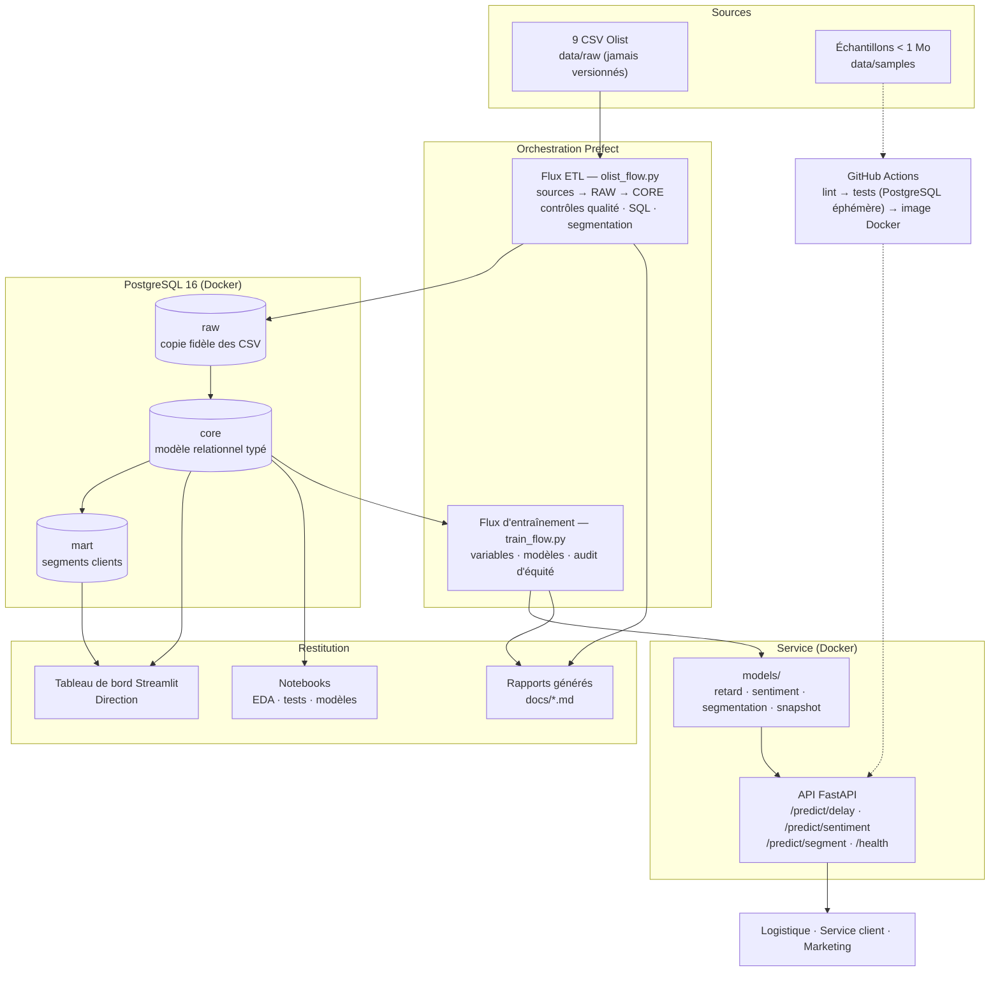

# Architecture cible — ShopPulse

## Les briques et leur rôle

| Brique | Rôle | Choix et raison |
|---|---|---|
| Sources | 9 CSV Olist, rechargés à chaque exécution | données complètes hors de Git ; échantillons générés par script pour les tests |
| Orchestration | deux flux Prefect : données (fréquent) et modèles (sur décision) | Python pur, sans serveur permanent (voir `docs/arbitrage.md`) |
| Stockage | PostgreSQL en trois couches : `raw` (brut), `core` (nettoyé, contraintes d'intégrité), `mart` (prêt à l'emploi) | chaque règle de nettoyage est traçable de `raw` à `core` |
| Qualité | 13 contrôles avant/après, dont 6 bloquants | le flux s'arrête plutôt que de charger une donnée fausse |
| Restitution | tableau de bord, notebooks, rapports Markdown régénérés | aucun chiffre saisi à la main |
| Modèles | fichiers `models/` produits par le flux d'entraînement | jamais versionnés, montés dans le conteneur de l'API |
| Service | API FastAPI dans une image Docker sans PyTorch, versions figées | validation des entrées, documentation OpenAPI, un modèle absent ne bloque pas les autres |
| Qualité logicielle | package `src/shoppulse`, 107 tests, CI à chaque push | le dépôt reste exécutable à tout moment |

## Les flux en une phrase

1. **Données** : `olist_flow.py` vérifie les fichiers, charge `raw`,
   alimente `core`, mesure la qualité, exécute les 8 requêtes SQL et calcule
   la segmentation (`mart`).
2. **Modèles** : `train_flow.py` construit les variables à partir de `core`,
   compare les modèles, audite l'équité, enregistre les modèles et le
   snapshot des historiques dans `models/`.
3. **Service** : l'API charge `models/` au démarrage et calcule les
   variables d'une nouvelle commande avec le même code que l'entraînement.
4. **Contrôle** : à chaque push, la CI rejoue les tests (dont le pipeline
   complet sur les échantillons) et construit l'image de l'API.

## Évolutions de l'architecture

En pointillé dans une version suivante : connexion de l'API à la base pour
des variables en temps réel, planification du réentraînement mensuel,
suivi des expériences (MLflow), supervision (ELK) et déploiement cloud de
l'image.
